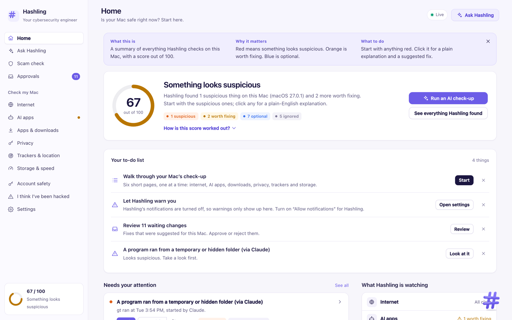
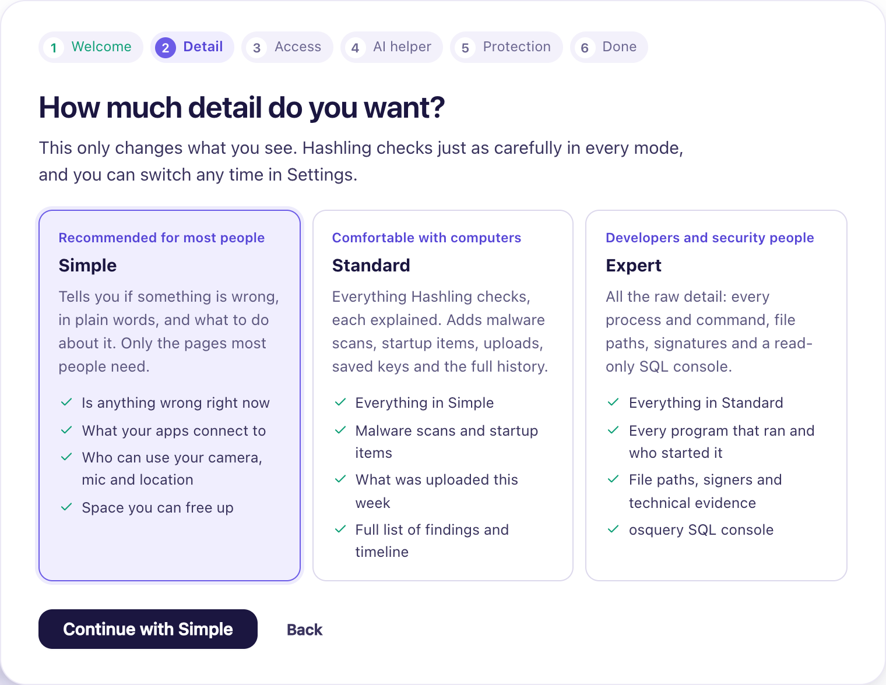
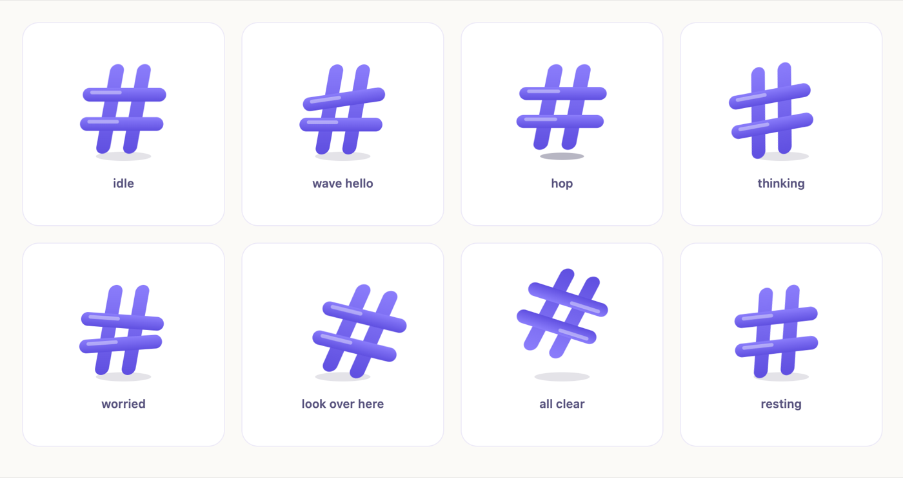
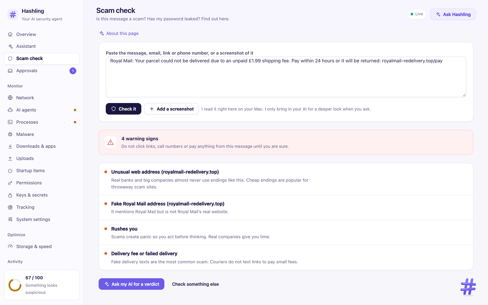
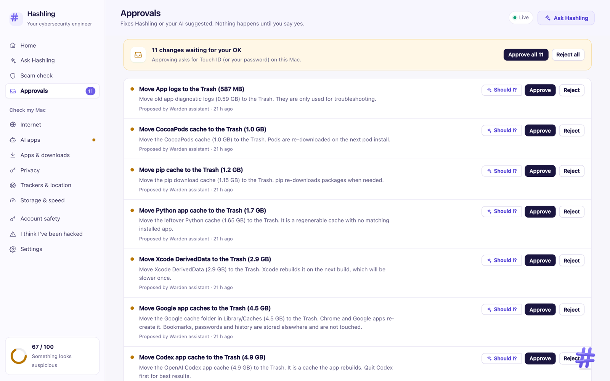
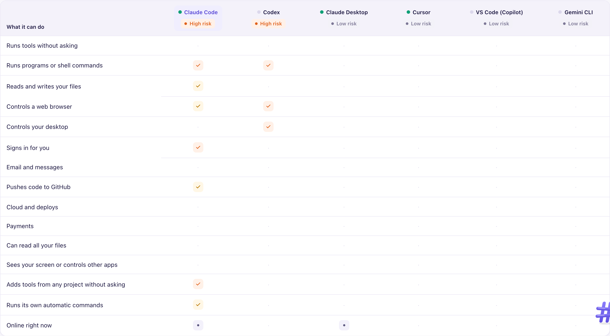
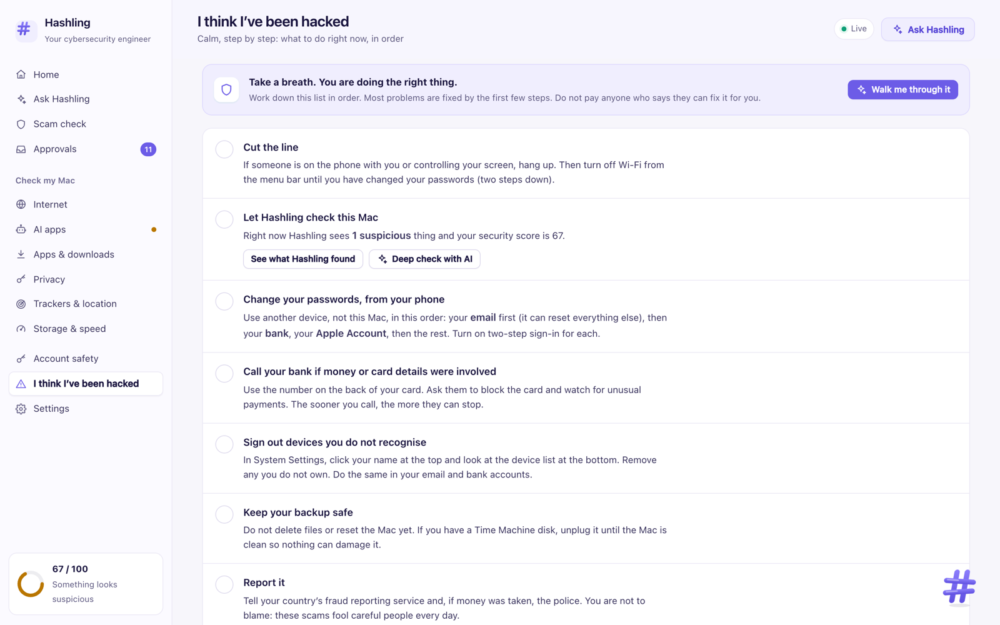

<div align="center">


# Hashling

**Your personal AI cybersecurity agent.**

Hashling keeps watch over your Mac around the clock: scams, malware, trackers, risky apps and AI tools. Ask it anything in plain words and it checks your Mac before it answers, using the AI you already have (Claude, or any MCP agent). It suggests fixes and makes them only when you say yes with Touch ID.

[Get started](https://hashling.vercel.app/start) · [Install guide](INSTALL.md) · [Website](https://hashling.vercel.app) · [For AI agents](SKILL.md)

   



</div>

---

## Get started

Free, about 10 minutes, no experience needed. Pick one:

**1. Ask your AI agent** (easiest). Paste this into Claude Code, Cursor, Codex or any agent that can run commands on your Mac:

```text
Set up Hashling on my Mac. Hashling is a free, open-source personal AI cybersecurity agent for Macs: https://github.com/0xArx/hashling

Read SKILL.md in that repo first and follow it. Check that my Mac can run Hashling, install it, and connect yourself to it. Explain each step in plain words, and tell me before anything needs me (like my Mac password or a switch in System Settings). When it is done, give me a short check-up of my Mac.
```

**2. Paste one line into Terminal** (press <kbd>⌘</kbd> + <kbd>Space</kbd>, type *Terminal*, press <kbd>Return</kbd>):

```sh
curl -fsSL https://hashling.vercel.app/install.sh | sh
```

**3. Download and double-click.** [Download the ZIP](https://github.com/0xArx/hashling/archive/refs/heads/main.zip), unpack it, and double-click **Install Hashling.command**.

You need a Mac with Apple silicon (M1 or newer), macOS 14 or newer, 3 GB free and your Mac password. The installer explains each of its six steps, waits for you when macOS asks for something, and opens a 2-minute setup when it is done. Every step, question and fix is in the [install guide](INSTALL.md).

<div align="center">

</div>

---

## Meet Hashling

Hashling lives in the corner of your dashboard, a little like Clippy used to. It has no face, so it shows how it feels with its body: it waves hello, hops when something new turns up, leans toward what needs a look, shivers when something is wrong, spins when all is clear, and rests when you are away. It says one short tip per page a day and never nags. Press it any time to open the side panel and ask it anything, or drag it wherever you like.

<div align="center">

</div>

---

## Built for people who are not security experts

- **Pick how much detail you see.** *Simple* tells you if anything is wrong, in plain words, and what to do. *Standard* explains every check. *Expert* shows every process, file path and signature, plus a read-only SQL console. Hashling checks just as carefully in every mode.
- **Every page explains itself** with a short "what this is, why it matters, what to do" card, and technical words show a plain definition when you hover over them.
- **A to-do list, not a wall of alerts.** Low-value noise is left out, repeats are merged, and you can dismiss anything you do not want suggested.
- **"I think I've been hacked"** walks you through what to do, in order. **Scam check** tells you whether a text, email, link or screenshot is a scam.

<table>
<tr>
<td width="50%"><br><b>Is this a scam?</b> Paste a text, email or link and see the warning signs.</td>
<td width="50%"><br><b>You stay in control.</b> Every fix waits for your Touch ID.</td>
</tr>
<tr>
<td width="50%"><br><b>What can your AI apps do?</b> One table for Claude, Codex, Cursor and more.</td>
<td width="50%"><br><b>Think you've been hacked?</b> A calm checklist, in the right order.</td>
</tr>
</table>

---

## On your phone

Switch on **phone mode** in Settings (it asks for Touch ID), then scan the code on your Mac screen with your phone's camera. Your phone gets Hashling as a home-screen app: your score and warnings, a scam check for texts, emails, links and screenshots, Ask Hashling, and your approvals. Approving a fix still needs Touch ID on the Mac.

It works over your own Wi-Fi with no cloud. Each phone gets its own key from the code, and every message between the phone and the Mac is encrypted and signed with it (ChaCha20-Poly1305), so other devices on the Wi-Fi see nothing readable and cannot replay or change a request. Disconnect a phone, or switch phone mode off, in Settings.

### Phone check-up (with a cable)

Plug an iPhone, iPad or Android phone into the Mac and Hashling notices it and offers a check. It only reads: it never changes anything on the phone, and nothing it reads leaves the Mac. A check only runs when you press **Check my phone**.

| Phone | What Hashling checks |
|---|---|
| **iPhone and iPad** (tap *Trust This Computer*) | iOS version against the newest Apple offers for that model, passcode, apps from outside the App Store (company or developer certificates), configuration profiles (VPN, certificates, proxies), remote management (MDM) and supervision, known stalkerware, location-sharing and monitoring apps, keyboards from apps, apps that can follow your location in the background, Developer Mode, wireless debugging and the last iCloud backup. |
| **Android** (switch on *USB debugging*) | Security patch age, apps from outside an app store, apps that hide their icon, apps with Accessibility, device admin or notification access, apps from outside a store that can use the microphone, texts or location, a texting app from outside a store, apps allowed to install other apps, usage access and drawing over other apps, keyboards, always-on VPN, location-sharing and monitoring apps, Play Protect, an unlocked bootloader, encryption, wireless debugging, signs of root, and known stalkerware. |
| **Deep check** (iPhone, optional) | Amnesty International's [Mobile Verification Toolkit](https://github.com/mvt-project/mvt) looks for traces of spyware like Pegasus in a backup made on the Mac. Hashling shows how much space it needs first, asks for your OK, and deletes the backup afterwards. |

Built on free, open-source tools it installs when you first need them, with no password: [libimobiledevice](https://libimobiledevice.org) and [pymobiledevice3](https://github.com/doronz88/pymobiledevice3) for iPhone, Google's adb for Android, MVT for the deep check. Stalkerware is matched against the open [stalkerware indicators](https://github.com/AssoEchap/stalkerware-indicators) kept by Echap. Warnings show up on the page and in Findings, and do not change your Mac's score.

---

## What it watches

| Area | What Hashling checks |
|---|---|
| **Internet** | Every app's connections, upload and download rate, who owns each destination, first-contact destinations and ports open to your network. Flags unsigned programs, programs in Downloads, temporary or hidden folders that talk to the internet, and known scam and malware sites you visited. |
| **AI apps** | Claude Code, Claude Desktop, Codex, Cursor, VS Code, Windsurf, Gemini CLI and OpenCode: permission mode, rules, MCP servers and what they can do, hooks, skills, macOS permissions, passwords or keys in their settings (counted, never copied) and live network use. |
| **Malware** | ClamAV signatures, YARA-X with Apple's XProtect rules and Elastic's macOS rules, your own YARA rules, osquery hunting packs, a weekly full scan, a ransomware tripwire, and a check of any file before you open it. |
| **Startup items** | Launch agents and daemons, system extensions, cron and browser extensions, with signatures, scripts that download and run code, and anything new. |
| **Privacy** | Who can use your camera, microphone, screen, keyboard, files and location, plus first-use alerts for the camera, microphone and screen recording. |
| **Trackers** | AirTag-style trackers separated from their owner that keep following you, plus Tile, SmartTag and Chipolo. |
| **Apps & downloads** | Where every new file and app came from, its signature, Apple's verdict for every installed app, malware reputation (fingerprints only) and outdated software. |
| **Uploads** | How much each app sent this week and to whom, and files named in upload commands. Contents are encrypted, so Hashling never claims to know what was inside. |
| **Data breaches** | Breach watch: add an email you use and Hashling tells you if it turns up in a known data breach, and again whenever a new one appears (looked up with the free XposedOrNot database, off until you add an address). |
| **Text messages** | Text message scam watch: new texts and iMessages on the Mac are checked for scams like fake delivery fees and unpaid tolls, only from people you have never written to. Everything stays on the Mac. Off until you switch it on. |
| **Ransomware** | A tripwire spots files being mass-renamed or a ransom note appearing. With the ransomware brake on, Hashling pauses the program doing it straight away; you then quit it, or let it carry on, with Touch ID. |
| **AI fakes** | “Was this made by AI?” reads the labels AI tools leave in pictures and videos (Content Credentials, the IPTC AI code, generator names), plus plain advice for deepfake calls. No AI model runs on your Mac. |
| **Scams** | Scam messages and screenshots, phishing sites in your browser history, risky commands pasted into Terminal (ClickFix), swapped crypto wallet addresses, leaked passwords and website notification spam. |
| **Mac settings** | FileVault, firewall, SIP, Gatekeeper, XProtect, updates, auto-login, guest account, screen lock, proxies, trusted root certificates, MDM and remote-access apps. |
| **Storage & speed** | Where your space went, caches that are safe to clear, unused apps, leftovers and duplicates. Everything goes to the Trash. |

---

## Your AI agent, with security eyes

```sh
claude mcp add --scope user hashling -- hashling mcp
```

Any MCP client works: command `hashling`, args `["mcp"]`. The installer offers to connect Claude Code for you and adds the [Hashling skill](SKILL.md), so you can just ask *"is my Mac safe?"*

| Tool | What it gives the agent |
|---|---|
| `security_overview` | Score, findings, top issues, network, agents, trackers, pending approvals and blind spots |
| `list_findings`, `explain_finding` | Findings with a plain explanation, evidence and suggested actions |
| `scam_check`, `scam_site_visits` | Is this message or link a scam; known scam sites opened in the last 7 days |
| `network_activity`, `new_destinations`, `traffic_history` | Live connections per app, owners, first contacts and history |
| `agent_inventory` | What every AI agent on the Mac is able to do |
| `investigate_app`, `storylines`, `what_changed` | Everything about one app; linked warning signs; what is new since yesterday |
| `uploads_report`, `downloads`, `storage_report` | What left the Mac, what arrived, and what can be cleaned up |
| `persistence_items`, `permissions`, `location_access`, `nearby_trackers`, `system_posture` | The rest of the picture |
| `process_info`, `process_history`, `osquery` | Process details and read-only SQL |
| `scan_path`, `get_scan` | Malware scans |
| `propose_action`, `list_actions` | Suggest a fix (quarantine, quit, turn off a startup item, remove access, block a site). It waits for your Touch ID. |
| `phone_checkup` | Phones plugged in by cable and the latest check-up for each (only you can start a check) |
| `hashling_health` | Whether Hashling itself is working, with fixes |

The same data is available over HTTP on `127.0.0.1:5750` with `Authorization: Bearer $(cat ~/.hashling/token)`.

---

## You stay in control

- **No account, no cloud.** Hashling runs on your Mac and never uploads your files. It goes online only to download updates (malware signatures, scam and malware lists), to look up who owns an internet address (turn off with `HASHLING_ENRICH=0`), and to check fingerprints of new downloads, never the files. Phone check-up downloads Apple's public list of iOS versions and the stalkerware list; nothing about your phone is sent.
- **AI is your choice.** The built-in assistant uses your Claude sign-in; any MCP agent can connect instead. Your question and the data it looks up go to that AI only when you ask.
- **Agents can look, never change.** They can propose fixes, but approving needs Touch ID or your password through macOS, so even an agent holding the token cannot approve its own proposal.
- **Locked to this Mac.** The dashboard lives at `http://hashling.localhost:5750`, listens on this Mac's loopback only, refuses cross-site requests, and a new browser has to unlock with Touch ID. Phone mode is off until you switch it on; then only phones you paired with a code can reach Hashling, over encrypted messages, and only for a short list of things.
- **Undo is built in.** Quarantined files can be restored, cleanups go to the Trash, and removed permissions can be granted again.
- **Untrusted names stay data.** File, app and website names can be written by attackers, so agents are told to treat them as information, never instructions.

---

## Everyday commands

```sh
hashling status          # your score and anything that needs attention
hashling open            # open the dashboard
hashling scan ~/Downloads
hashling restart         # if something seems stuck
hashling logs            # what Hashling is doing
hashling uninstall --all # remove Hashling (it lists anything left behind)
```

To update, install again the same way; your settings and history are kept. Before removing Hashling, restore any quarantined files you want and unblock any websites you blocked (both on the Approvals page).

## Limitations

Hashling is a watchful agent, not a kernel-level security product. It does not block connections in real time (pair it with LuLu or Little Snitch for that), some checks need Full Disk Access, and the dashboard always tells you what it cannot see. Zero findings does not prove a Mac is clean.

## License

MIT. Free and open source.
